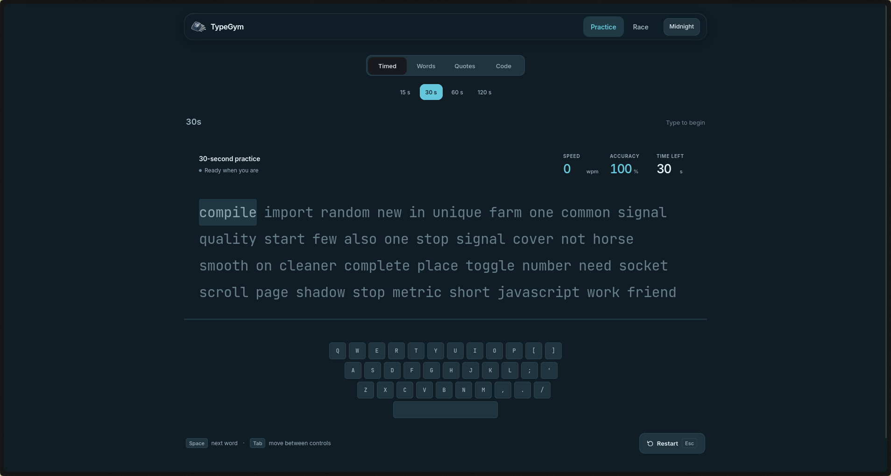

<div align="center">

# TypeGym

**Train your fingers. Feed your streak.**

[](https://typegym-io.vercel.app)
[](https://github.com/abhaypratap08/TypeGym/issues)

TypeGym is a typing app driven by curiosity, built for people who like getting sharper without making it feel boring.<br/>
Fast feedback, clean flow, and just enough challenge to keep you locked in.

[**Live Demo**](https://typegym-io.vercel.app) · [**Report an Issue**](https://github.com/abhaypratap08/TypeGym/issues)

<br/>


<br/>
<sub><b>Graphite</b></sub>

</div>

---

## Features

- **Timed, Words, Quotes & Code** modes, with 15 / 30 / 60 / 120 s sessions
- **Practice or Race**, solo drills or head-to-head
- **Live feedback**: speed, accuracy and time left as you type
- **Multiple themes**: Graphite, Midnight, Legacy, Olive and Light
- **Keyboard-first**: `Space` next word · `Tab` move between controls · `Esc` restart
  
## Themes

<div align="center">

<a href="./assets/theme-midnight.png"></a>
&nbsp;
<a href="./assets/theme-legacy.png"></a>
<br/><br/>
<a href="./assets/theme-olive.png"></a>
&nbsp;
<a href="./assets/theme-graphite.png"></a>

<br/>

<sub><b>Midnight</b> · <b>Legacy</b> · <b>Olive</b> · <b>Graphite</b> — click a screenshot to enlarge</sub>

</div>

## Run locally

```bash
git clone https://github.com/abhaypratap08/TypeGym.git
cd TypeGym
npm install
npm run dev
```

Then open <http://localhost:3000>.

## Feedback

If anything feels broken, weird, or off, please [register an issue](https://github.com/abhaypratap08/TypeGym/issues).

<div align="center">
<sub>LIVE @ <a href="https://typegym-io.vercel.app">typegym-io.vercel.app</a></sub>
</div>
